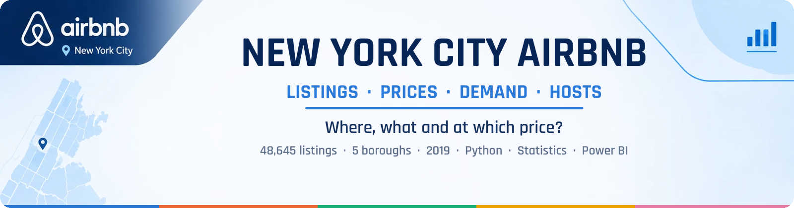
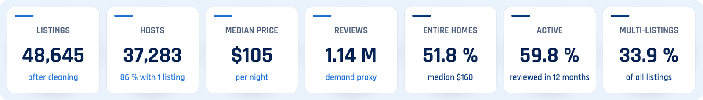
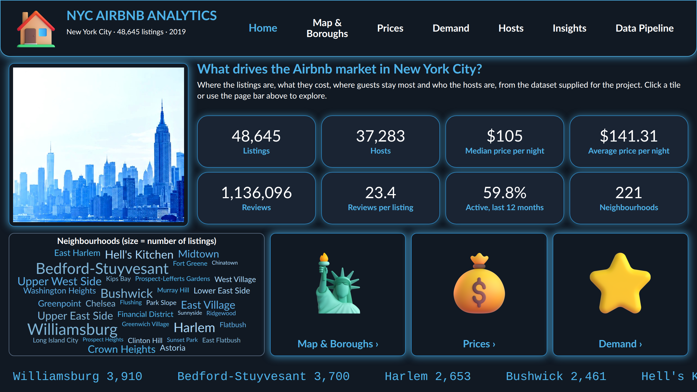
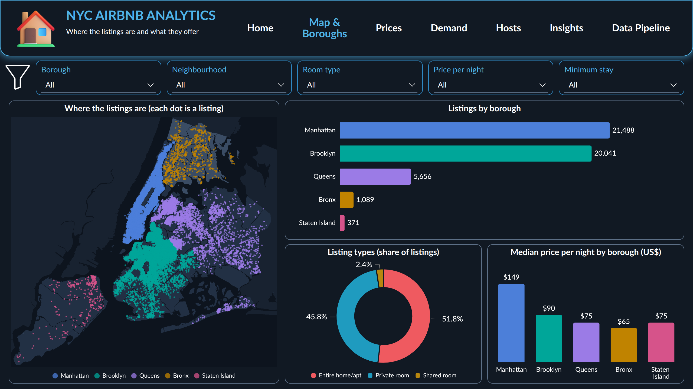
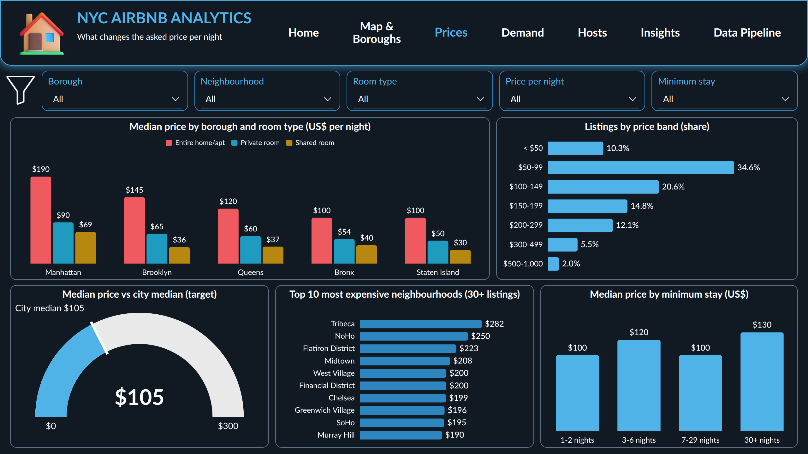
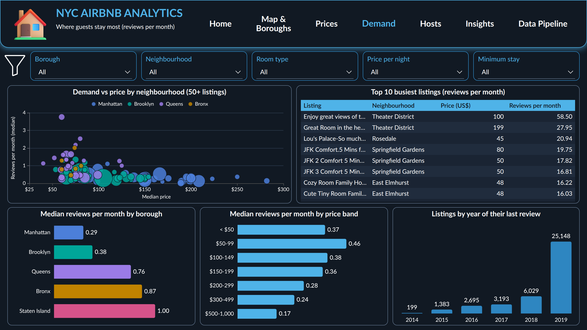
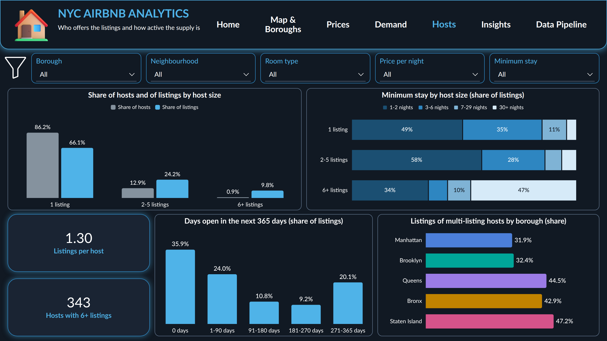
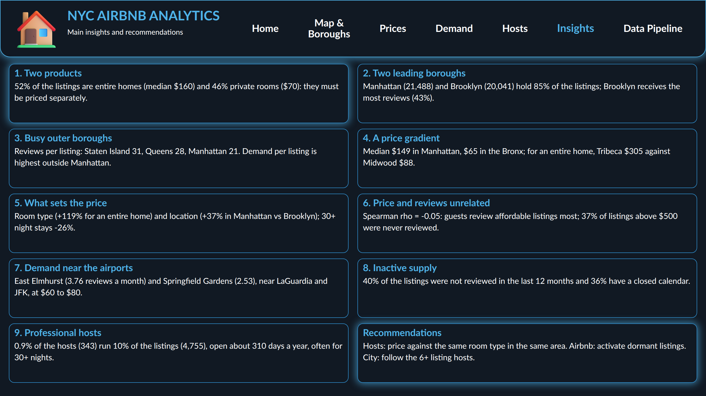
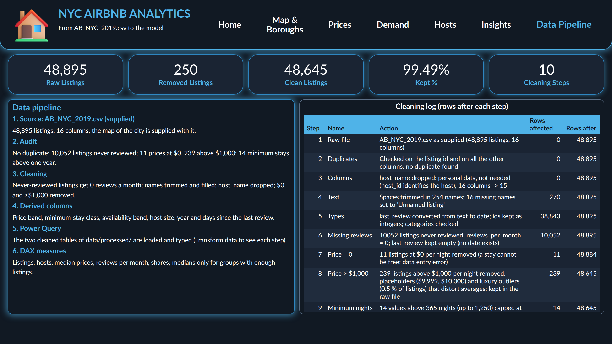
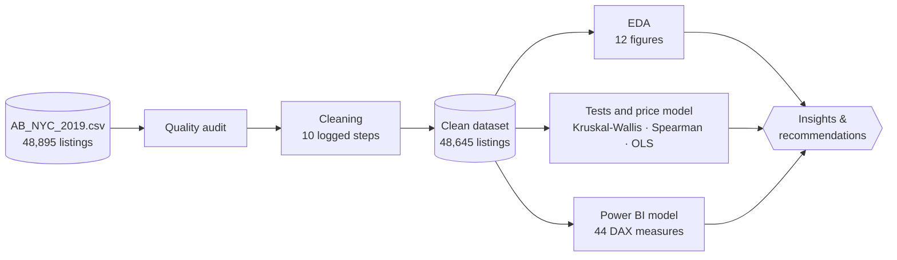

<div align="center">



<br>

[](https://colab.research.google.com/github/koffifidelek59-collab/nyc-airbnb-analytics/blob/main/NYC-Airbnb-Analytics.ipynb)


**Data understanding &nbsp;·&nbsp; Cleaning &nbsp;·&nbsp; Exploratory analysis &nbsp;·&nbsp; Price model &nbsp;·&nbsp; Power BI dashboard &nbsp;·&nbsp; Recommendations**

<sub>

[**Question**](#-the-business-question) &nbsp;•&nbsp; [**Answers**](#-seven-questions-seven-answers) &nbsp;•&nbsp; [**Recommendations**](#-recommendations) &nbsp;•&nbsp; [**Dashboard**](#-the-dashboard) &nbsp;•&nbsp; [**Method**](#-method) &nbsp;•&nbsp; [**Run it**](#-run-it)

</sub>

</div>

<br>

## 🎯 The business question

Airbnb has become a large part of the accommodation offer of New York City. Hosts want to know where and at which price to list, Airbnb wants to understand supply and demand in each area, and the city follows how short-term rentals spread across neighbourhoods:

<table>
<tr>
<td>

**Which listing types dominate? Which areas are the most active? How do prices differ, and what drives them? Do price and reviews go together? Which areas and listings perform best, and what patterns stand out?**

</td>
</tr>
</table>

This final project (Task 12) answers each question with evidence, on **the supplied dataset only**, through a reproducible pipeline: **one raw file → a clean dataset → a tested analysis → a 7-page interactive dashboard → actionable recommendations.**



> [!NOTE]
> Prices are **asked prices per night** (US$). The file has **no rating column**: demand is measured by **reviews**, which count stays, not satisfaction.

<br>

## ❓ Seven questions, seven answers

| | Question | Answer | |
|:---:|---|---|:---:|
| **Q1** | **Most common listing types?** | **Entire homes** (51.8 %, median \$160) and **private rooms** (45.8 %, \$70): two different products. Shared rooms are 2.4 %. | <sub>Fig. 1</sub> |
| **Q2** | **Most active areas?** | **Manhattan and Brooklyn** hold 85 % of the listings; **Brooklyn gets the most reviews** (42.8 %) and **Bedford-Stuyvesant** is the most reviewed neighbourhood. | <sub>Fig. 2-4</sub> |
| **Q3** | **Prices across areas?** | Median **\$149 in Manhattan**, \$90 in Brooklyn, **\$65 in the Bronx**; for an entire home, **Tribeca \$305** vs Midwood \$88. | <sub>Fig. 5-7</sub> |
| **Q4** | **Price, ratings and reviews?** | No ratings in the file. **Price and reviews are unrelated** (ρ = -0.05); 37 % of listings above \$500 were never reviewed. | <sub>Fig. 8</sub> |
| **Q5** | **What drives the price?** | **Room type** (entire home **+119 %**) and **location** (Manhattan **+37 %** vs Brooklyn); 30+ night stays **-26 %**; host size: no effect. R² = 0.52. | <sub>Fig. 9</sub> |
| **Q6** | **Best performers?** | **Cheap rooms near the airports**: East Elmhurst (LGA) **3.76** and Springfield Gardens (JFK) **2.53** reviews per month, at \$60-80. | <sub>Fig. 10</sub> |
| **Q7** | **Patterns?** | **40 % of listings look inactive**; **0.9 % of hosts run 10 % of the listings**, open 310 days a year, half with 30+ night stays. | <sub>Fig. 11-12</sub> |

<table>
<tr>
<td width="50%" valign="top">

### 🗽 Two markets in one
An entire home and a private room are **two products**: compare prices and competitors within a room type, never across.

</td>
<td width="50%" valign="top">

### ✈️ Demand is where supply is short
Staten Island (31) and Queens (28) get **more reviews per listing** than Manhattan (21).

</td>
</tr>
</table>

<br>

## 💡 Recommendations

| | Recommendation | Evidence |
|:---:|---|---|
| **1** | 🏷️ **Hosts: price against the right benchmark** | The median of the same room type in the same neighbourhood, not the city average (3.5 to 1 between neighbourhoods). |
| **2** | 🚇 **Hosts: consider outer boroughs and transport hubs** | Rooms near JFK and LaGuardia are the most booked listings of the city. |
| **3** | 📅 **Hosts: open the calendar, shorten the minimum stay** | Demand rises with availability (ρ = +0.30) and falls with the minimum stay (ρ = -0.25). |
| **4** | 💤 **Airbnb: activate dormant supply** | 20 % of listings never reviewed, 36 % with a closed calendar. |
| **5** | 📍 **Airbnb: recruit hosts where demand per listing is high** | Queens, the Bronx and Staten Island rather than saturated central areas. |
| **6** | 🧭 **Airbnb: segment the offer by guest type** | Short convenience trips, leisure in Manhattan, monthly rentals. |
| **7** | 🏛️ **City: monitor the professional segment** | 343 hosts with 4,755 listings, identified by host size, availability and minimum stay. |
| **8** | ⭐ **Next analysis: add ratings, bookings and size** | To move from demand proxies to satisfaction, occupancy and revenue. |

<br>

## 🖥 The dashboard

<div align="center">

**Power BI · 7 pages · 44 DAX measures**<br>
<sub>Dark navy theme with a blue glow · page navigator · KPI cards · 5 synchronised filters (borough, neighbourhood, room type, price, minimum stay) · map of 48,645 listings · word cloud of the neighbourhoods · clickable picture tiles · gauge against the city median · cross-filtering · tooltips · business labels · measures in display folders · top-ten visuals that follow the filters</sub>

</div>

<p align="center"><br><b>Home</b> · <sub>KPIs, neighbourhoods, entry tiles</sub></p>

<table>
<tr>
<td width="50%" align="center"><br><b>Map &amp; Boroughs</b><br><sub>Q1 · Q2</sub></td>
<td width="50%" align="center"><br><b>Prices</b><br><sub>Q3 · Q5</sub></td>
</tr>
<tr>
<td align="center"><br><b>Demand</b><br><sub>Q2 · Q4 · Q6</sub></td>
<td align="center"><br><b>Hosts</b><br><sub>Q7</sub></td>
</tr>
<tr>
<td align="center"><br><b>Insights</b><br><sub>Findings and recommendations</sub></td>
<td align="center"><br><b>Data Pipeline</b><br><sub>From the supplied file to the model</sub></td>
</tr>
</table>

<br>

## 🎤 The presentation

A 20-slide deck, [`presentation/NYC_Airbnb_Final_Presentation.pptx`](presentation/NYC_Airbnb_Final_Presentation.pptx): roadmap, the brief, the dataset, the cleaning, the key figures, one slide per question with native charts, the dashboard, insights, recommendations and conclusion.

<br>

## 🧪 Method



<details>
<summary><b>🧹 Data quality: issues found and treated</b> <sub>(click to expand)</sub></summary>
<br>

Every step is recorded in [`data/processed/cleaning_log.csv`](data/processed/cleaning_log.csv) and shown on the dashboard's Data Pipeline page.

| Issue | Treatment |
|---|---|
| 10,052 missing review dates and rates, all for listings with 0 reviews | Rate set to 0, date left empty, flag `has_reviews` |
| 16 missing listing names, 254 names with extra spaces | Filled with *Unnamed listing*, trimmed |
| 21 missing host names | Column dropped (personal data, not needed) |
| `last_review` stored as text | Converted to a date |
| 11 prices at \$0 | Removed (a stay cannot be free) |
| 239 prices above \$1,000, including \$9,999 and \$10,000 placeholders | Removed from the analysis set |
| 14 minimum stays above 365 nights (up to 1,250) | Capped at 365 |
| Map file named `.png` that is in fact a JPEG | Read by its content |

**48,895 raw listings → 48,645 clean listings (99.49 % kept), median price \$106 → \$105.**

</details>

<details>
<summary><b>📐 Statistical approach</b> <sub>(click to expand)</sub></summary>
<br>

- **Medians and rank-based tests** (Kruskal-Wallis with ε², Spearman, Mann-Whitney), because prices and reviews are heavily skewed.
- **95 % bootstrap confidence intervals** for the correlations.
- A **multiple regression of the log price** (robust HC3 errors) that measures each factor with the others held constant.

</details>

<details>
<summary><b>📁 Repository structure</b> <sub>(click to expand)</sub></summary>
<br>

```
nyc-airbnb-analytics/
├── NYC-Airbnb-Analytics.ipynb      # Full analysis, step by step
├── report.pdf                      # Final report: figures, dashboard, insights, recommendations
├── report.tex                      # LaTeX source of the report
├── presentation/
│   └── NYC_Airbnb_Final_Presentation.pptx   # Final presentation (20 slides)
├── data/
│   ├── raw/                        # The supplied files, unchanged (CSV + map)
│   └── processed/                  # Written by the notebook
│       ├── airbnb_nyc_clean.csv    # Clean dataset (48,645 listings, 29 columns)
│       └── cleaning_log.csv        # Every cleaning step
├── powerbi/
│   ├── NYC_Airbnb_Dashboard.pbix   # Power BI dashboard (7 pages)
│   ├── PowerQuery_pipeline.m       # Power Query (M) code
│   ├── DAX_measures.dax            # The 44 DAX measures
│   └── nyc_airbnb_theme.json       # Report theme (colours, fonts)
├── figures/                        # fig01-fig12 (PNG + PDF), dashboard/ and readme/ visuals
└── results/                        # KPI and result tables (CSV)
```

</details>

<br>

## 🚀 Run it

<table>
<tr>
<td width="50%" valign="top">

**☁️ Google Colab**

Click **Open in Colab** above, then *Runtime → Run all*.<br>
Missing data files are downloaded automatically.

</td>
<td width="50%" valign="top">

**📊 Power BI**

Open `powerbi/NYC_Airbnb_Dashboard.pbix` in Power BI Desktop.<br>
The dashboard reads `data/processed/`: after cloning, set the **DataFolder** parameter (*Transform data → Edit parameters*) to that folder, then *Refresh*.

</td>
</tr>
</table>

**💻 Locally**

```bash
git clone https://github.com/koffifidelek59-collab/nyc-airbnb-analytics.git
cd nyc-airbnb-analytics
pip install pandas numpy scipy statsmodels matplotlib pillow jupyter
jupyter notebook NYC-Airbnb-Analytics.ipynb
```

<br>

## 📚 Data source and limitations

- **`AB_NYC_2019.csv`** and **`New_York_City_.png`**, the dataset supplied for the final project (Task 12): 48,895 listings, last review on 8 July 2019. No other data is used.

> [!IMPORTANT]
> No ratings, bookings or revenue · prices are asked prices · no property size or amenities (the price model stops at R² = 0.52) · one snapshot · listings above \$1,000 per night excluded · correlations describe associations, not causes.

<br>

## 🛠 Tech stack

<div align="center">


</div>

<br>

## 👤 Author

<table>
<tr>
<td>

**KOUAME Koffi Fidèle**<br>
Data Analysis Internship · Task 12 (final project)<br>
MSc Energy and Green Hydrogen (System Analysis), WASCAL IMP-EGH

[](mailto:koffifidelek59@gmail.com)
[](https://www.linkedin.com/in/koffi-fidele-kouame/)
[](https://github.com/koffifidelek59-collab)

</td>
</tr>
</table>

<div align="center">

<sub>Code and documentation under the [MIT License](LICENSE) · data under the terms of their original sources</sub>

⭐ **If this project is useful to you, consider giving it a star.**

</div>
