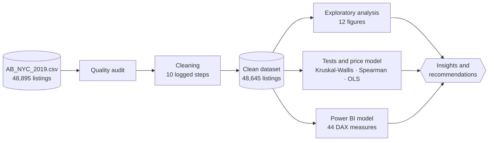

<div align="center">

# New York City Airbnb Market Analytics

**Supply, pricing and demand across 48,645 listings: a reproducible analysis and an interactive Power BI dashboard**

[](NYC-Airbnb-Analytics.ipynb)
[](NYC-Airbnb-Analytics.ipynb)
[](powerbi/)
[](https://colab.research.google.com/github/koffifidelek59-collab/nyc-airbnb-analytics/blob/main/NYC-Airbnb-Analytics.ipynb)
[](LICENSE)

[**Report**](report.pdf) &nbsp;·&nbsp; [**Notebook**](NYC-Airbnb-Analytics.ipynb) &nbsp;·&nbsp; [**Dashboard**](powerbi/) &nbsp;·&nbsp; [**Slides**](presentation/NYC_Airbnb_Final_Presentation.pptx)

<br>


</div>

<br>

## Executive summary

Airbnb has become a large part of the accommodation offer of New York City. Hosts need to know where and at which price to list, Airbnb needs to understand supply and demand in each area, and the city follows how short-term rentals spread across its neighbourhoods.

> **Business questions.** Which listing types dominate? Which areas are the most active? How do prices differ, and what drives them? Do price and reviews go together? Which areas and listings perform best, and what patterns stand out?

This final project (Task 12) answers each question with evidence from **the supplied dataset only**, through a reproducible pipeline: one raw file, an audited and cleaned dataset, statistical tests and a price model, a seven-page interactive dashboard and actionable recommendations.

<table>
<tr>
<td align="center" width="25%"><h2>48,645</h2><b>listings analysed</b><br><sub>99.49 % of the raw file kept after cleaning</sub></td>
<td align="center" width="25%"><h2>&#36;105</h2><b>median price per night</b><br><sub>&#36;149 in Manhattan, &#36;65 in the Bronx</sub></td>
<td align="center" width="25%"><h2>+119 %</h2><b>price premium of an entire home</b><br><sub>the strongest price driver, all else equal</sub></td>
<td align="center" width="25%"><h2>40 %</h2><b>of listings look inactive</b><br><sub>a large pool of dormant supply</sub></td>
</tr>
</table>

> [!NOTE]
> Prices are asked prices per night (US$). The file has no rating column: demand is measured by reviews, which count stays, not satisfaction.

<br>

## Results

| | Question | Answer | Evidence |
|:---:|:---|:---|:---:|
| **Q1** | Most common listing types | **Entire homes** (51.8 %, median \$160) and **private rooms** (45.8 %, \$70) are two different products; shared rooms are 2.4 %. | Fig. 1 |
| **Q2** | Most active areas | **Manhattan and Brooklyn** hold 85 % of the listings; **Brooklyn gets the most reviews** (42.8 %) and **Bedford-Stuyvesant** is the most reviewed neighbourhood. | Fig. 2-4 |
| **Q3** | Prices across areas | Median **\$149 in Manhattan**, \$90 in Brooklyn and **\$65 in the Bronx**; for an entire home, **Tribeca \$305** against \$88 in Midwood. | Fig. 5-7 |
| **Q4** | Price, ratings and reviews | No ratings in the file. **Price and reviews are unrelated** (ρ = -0.05); 37 % of listings above \$500 were never reviewed. | Fig. 8 |
| **Q5** | What drives the price | **Room type** (entire home **+119 %**) and **location** (Manhattan **+37 %** against Brooklyn); stays of 30+ nights **-26 %**; host size has no effect. R² = 0.52. | Fig. 9 |
| **Q6** | Best performers | **Inexpensive rooms near the airports**: East Elmhurst (LaGuardia) **3.76** and Springfield Gardens (JFK) **2.53** reviews per month, at \$60-80. | Fig. 10 |
| **Q7** | Patterns | **40 % of listings look inactive**; **0.9 % of hosts run 10 % of the listings**, open 310 days a year, half of them with stays of 30+ nights. | Fig. 11-12 |

### Key findings

1. **Two markets in one.** An entire home and a private room are two different products: prices and competitors should be compared within a room type, never across.
2. **Room type and location set the price, not popularity.** They are the main price drivers in the model, while price and number of reviews are unrelated.
3. **Demand is strongest where supply is short.** Staten Island (31) and Queens (28) receive more reviews per listing than Manhattan (21), and the most booked listings are inexpensive rooms near the airports.
4. **A professional segment exists.** A small group of hosts runs a disproportionate share of the listings, with high availability and long minimum stays.

<br>

## Recommendations

| Audience | Recommendation | Evidence |
|:---|:---|:---|
| **Hosts** | Price against the median of the same room type in the same neighbourhood, not the city average | Prices vary 3.5 to 1 between neighbourhoods |
| **Hosts** | Consider outer boroughs and transport hubs | Rooms near JFK and LaGuardia are the most booked listings of the city |
| **Hosts** | Open the calendar and shorten the minimum stay | Demand rises with availability (ρ = +0.30) and falls with the minimum stay (ρ = -0.25) |
| **Airbnb** | Activate dormant supply | 20 % of listings never reviewed, 36 % with a closed calendar |
| **Airbnb** | Recruit hosts where demand per listing is high | Queens, the Bronx and Staten Island rather than saturated central areas |
| **Airbnb** | Segment the offer by guest type | Short convenience trips, leisure stays in Manhattan, monthly rentals |
| **City** | Monitor the professional segment | 343 hosts with 4,755 listings, identified by host size, availability and minimum stay |
| **Next study** | Add ratings, bookings and property size | Moves the analysis from demand proxies to satisfaction, occupancy and revenue |

<br>

## Interactive dashboard

A seven-page Power BI report with 44 DAX measures. It opens on a home page with the key figures, a word cloud of the neighbourhoods, picture tiles that lead to each analysis and a scrolling ticker. Five synchronised filters (borough, neighbourhood, room type, price, minimum stay) update every page, including a map of the 48,645 listings.

<table>
<tr>
<td width="50%" align="center"><br><sub><b>Map & Boroughs</b>: where the listings are (Q1, Q2)</sub></td>
<td width="50%" align="center"><br><sub><b>Prices</b>: levels and drivers (Q3, Q5)</sub></td>
</tr>
<tr>
<td align="center"><br><sub><b>Demand</b>: reviews and best performers (Q2, Q4, Q6)</sub></td>
<td align="center"><br><sub><b>Hosts</b>: the professional segment (Q7)</sub></td>
</tr>
<tr>
<td align="center"><br><sub><b>Insights</b>: findings and recommendations</sub></td>
<td align="center"><br><sub><b>Data Pipeline</b>: from the supplied file to the model</sub></td>
</tr>
</table>

Open `powerbi/NYC_Airbnb_Dashboard.pbix` in Power BI Desktop. The report reads `data/processed/`: after cloning, set the **DataFolder** parameter (*Transform data → Edit parameters*) to that folder, then select **Refresh**.

<br>

## Methodology



| Stage | Method | Why |
|:---|:---|:---|
| **Descriptive statistics** | Medians and shares by room type, borough and neighbourhood | Prices and reviews are heavily skewed |
| **Group comparisons** | Kruskal-Wallis with ε², Mann-Whitney | Rank-based tests that do not assume normality |
| **Associations** | Spearman correlations with 95 % bootstrap confidence intervals | Robust to outliers; captures monotonic relationships |
| **Price drivers** | Multiple regression of the log price, robust HC3 errors | Measures each factor with the others held constant |

<details>
<summary><b>Data quality report</b></summary>
<br>

| Issue | Treatment |
|:---|:---|
| 10,052 missing review dates and rates, all for listings with 0 reviews | Rate set to 0, date left empty, flag `has_reviews` |
| 16 missing listing names, 254 names with extra spaces | Filled with *Unnamed listing*, trimmed |
| 21 missing host names | Column dropped (personal data, not needed) |
| `last_review` stored as text | Converted to a date |
| 11 prices at \$0 | Removed (a stay cannot be free) |
| 239 prices above \$1,000, including \$9,999 and \$10,000 placeholders | Removed from the analysis set |
| 14 minimum stays above 365 nights (up to 1,250) | Capped at 365 |
| Map file named `.png` that is in fact a JPEG | Read by its content |

**48,895 raw listings → 48,645 clean listings (99.49 % kept); median price \$106 → \$105.** Every step is logged in [`data/processed/cleaning_log.csv`](data/processed/cleaning_log.csv) and shown on the dashboard's Data Pipeline page.

</details>

<br>

## Data

| Item | Description |
|:---|:---|
| **Files** | `AB_NYC_2019.csv` and `New_York_City_.png`, the dataset supplied for the final project (Task 12) |
| **Content** | 48,895 listings with location, room type, price, minimum stay, reviews, host and availability |
| **Period** | Snapshot; last review on 8 July 2019 |
| **Scope** | No other data is used |

<br>

## Reproduce the analysis

[](https://colab.research.google.com/github/koffifidelek59-collab/nyc-airbnb-analytics/blob/main/NYC-Airbnb-Analytics.ipynb)

In Colab, select *Runtime → Run all*; missing data files are downloaded automatically. Locally:

```bash
git clone https://github.com/koffifidelek59-collab/nyc-airbnb-analytics.git
cd nyc-airbnb-analytics
pip install pandas numpy scipy statsmodels matplotlib pillow jupyter
jupyter notebook NYC-Airbnb-Analytics.ipynb
```

<details>
<summary><b>Repository structure</b></summary>
<br>

```
nyc-airbnb-analytics/
├── NYC-Airbnb-Analytics.ipynb   full analysis, step by step
├── report.pdf                   final report: figures, dashboard, insights, recommendations
├── report.tex                   LaTeX source of the report
├── presentation/                final presentation (20 slides)
├── data/
│   ├── raw/                     the supplied files, unchanged (CSV and map)
│   └── processed/               clean dataset (48,645 listings, 29 columns) and cleaning log
├── powerbi/                     dashboard (7 pages), Power Query code, 44 DAX measures, theme
├── figures/                     12 figures (PNG and PDF) and the dashboard captures
├── results/                     key figures and result tables (CSV)
├── CITATION.cff
└── LICENSE
```

</details>

<br>

## Limitations

- No ratings, bookings or revenue: demand is measured by reviews.
- Prices are asked prices, not prices paid.
- No property size or amenities, so the price model stops at R² = 0.52.
- One snapshot in time; listings above \$1,000 per night are excluded.
- Correlations describe associations, not causes.

<br>

## Citation

```bibtex
@misc{kouame2026nycairbnb,
  author       = {Kouame, Koffi Fid{\`e}le},
  title        = {New York City Airbnb Market Analytics: Supply, Pricing and Demand across 48,645 Listings},
  year         = {2026},
  howpublished = {\url{https://github.com/koffifidelek59-collab/nyc-airbnb-analytics}}
}
```

<br>

## Author

**KOUAME Koffi Fidèle** · Data Analysis Internship, Task 12 (final project) · MSc Energy and Green Hydrogen (System Analysis), WASCAL IMP-EGH

[](mailto:koffifidelek59@gmail.com)
[](https://www.linkedin.com/in/koffi-fidele-kouame/)
[](https://github.com/koffifidelek59-collab)

<sub>Code and documentation are released under the [MIT License](LICENSE). Data remain subject to the terms of their original sources.</sub>
